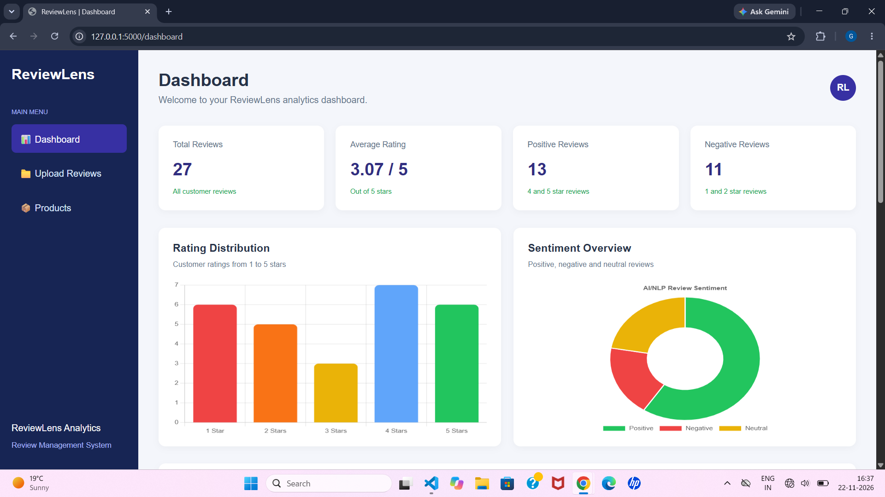
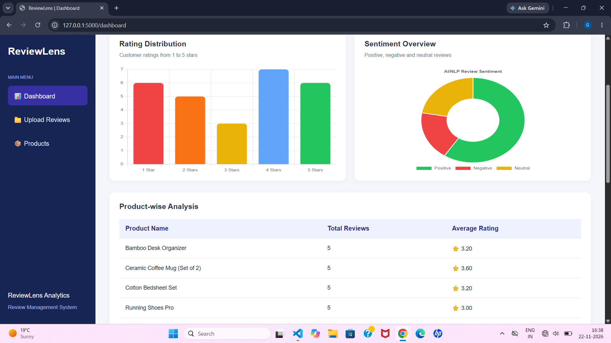
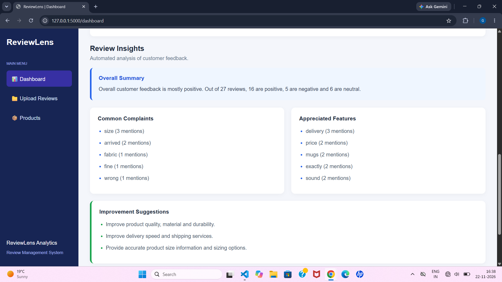

# ReviewLens – Customer Review Analytics Dashboard

ReviewLens is a web-based customer review analytics application that helps businesses understand customer feedback through sentiment analysis, interactive visualizations, and automated review insights.

The application allows users to upload customer review data in CSV format and automatically analyzes reviews to identify positive, negative, and neutral sentiments.

## 🚀 Features

- **CSV Upload:** Upload customer review datasets in CSV format.
- **Sentiment Analysis:** Analyze customer reviews using VADER sentiment analysis.
- **Dashboard Analytics:** View total reviews, average ratings, and sentiment counts.
- **Rating Distribution:** Visualize customer ratings using bar charts.
- **Sentiment Visualization:** Display positive, negative, and neutral reviews using doughnut charts.
- **Product-wise Analysis:** Compare average ratings and reviews across different products.
- **Automated Review Insights:** Identify common complaints, appreciated features, and improvement suggestions.
- **Interactive Dashboard:** View analysis results through a user-friendly interface.

## 🛠️ Technologies Used

### Frontend
- HTML5
- CSS3
- JavaScript
- Chart.js

### Backend
- Python
- Flask
- REST API

### Data Analysis
- Pandas
- VADER Sentiment Analysis

### Tools
- Visual Studio Code
- Git
- GitHub

## 📂 Project Structure

```text
ReviewLens/
│
├── backend/
│   ├── app.py
│   ├── config.py
│   └── services/
│       ├── ai_analyzer.py
│       ├── cache.py
│       ├── csv_cleaner.py
│       ├── dashboard.py
│       ├── insights.py
│       └── sentiment.py
│
├── frontend/
│   ├── static/
│   │   ├── script.js
│   │   └── style.css
│   │
│   └── templates/
│       ├── dashboard.html
│       └── index.html
│
├── data/
├── tests/
│
├── README.md
├── requirements.txt
└── .gitignore
```

## ⚙️ Installation and Setup

### 1. Clone the Repository

```bash
git clone https://github.com/gargi-tiwari312/ReviewLens.git
```

### 2. Navigate to the Project Directory

```bash
cd ReviewLens
```

### 3. Create a Virtual Environment

```bash
python -m venv venv
```

### 4. Activate Virtual Environment

For Windows:

```bash
venv\Scripts\activate
```

### 5. Install Dependencies

```bash
pip install -r requirements.txt
```

### 6. Run the Application

```bash
python backend/app.py
```

### 7. Open in Browser

Open the local URL displayed in your terminal, usually:

```text
http://127.0.0.1:5000/
```

## 📊 How It Works

1. Open the ReviewLens web application.
2. Upload a customer review CSV file.
3. The backend processes and cleans the uploaded data.
4. Sentiment analysis classifies reviews as positive, negative, or neutral.
5. Dashboard statistics and charts are generated.
6. Automated insights highlight customer complaints, appreciated features, and improvement suggestions.

## 📁 Dataset Format

The uploaded CSV file should contain the following columns:

| Column | Description |
|---|---|
| review_id | Unique review identifier |
| product | Product name |
| rating | Customer rating |
| date | Review date |
| review_text | Customer feedback |

Example:

```csv
review_id,product,rating,date,review_text
R001,Cotton Bedsheet Set,5,2026-10-02,"Super soft fabric and worth the price."
R002,Cotton Bedsheet Set,2,2026-10-03,"The product size is incorrect."
```

## 🎯 Objective

The main objective of ReviewLens is to simplify customer feedback analysis and help businesses make better decisions by understanding customer satisfaction, identifying product issues, and discovering areas for improvement.

## 🔮 Future Enhancements

- Advanced machine learning-based sentiment analysis.
- Word cloud visualization.
- PDF and Excel report generation.
- Real-time review analysis.
- Product recommendation insights.
- User authentication and admin panel.


## 📸 Application Screenshots

### 1. ReviewLens Dashboard


### 2. Review Charts and Sentiment Analysis


### 3. AI Segment Analysis


## 👩‍💻 Author

**Gargi Tiwari**

GitHub: https://github.com/gargi-tiwari312

## 📜 License

This project is developed for academic and educational purposes.
